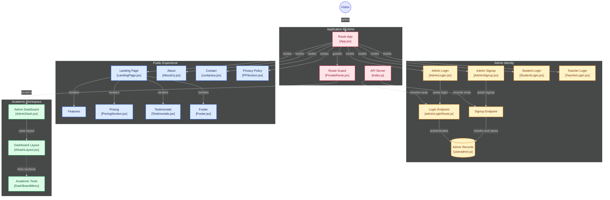

# Gradyze

An academic management platform with role-based dashboards for administrators, teachers, and students — built as a full-stack web application.

<p align="center">
  
  
  
  
  
</p>

---

## What it does

Gradyze handles the operational side of an academic institution:

- **Public marketing site** — landing page, features, pricing, testimonials, about, contact, privacy
- **Role-based authentication** — separate login flows for Admin, Teacher, and Student
- **Admin workspace** — protected dashboard with academic management tools
- **REST API backend** — Express server with MongoDB for record storage

---

## Architecture



Generated with [GitDiagram](https://gitdiagram.com).

---

## Project Structure

```
gradyze/
└── Gradyze.com/
    └── Gradyze/
        ├── FrontEnd/
        │   └── src/
        │       ├── Pages/
        │       │   ├── LandingPage/
        │       │   ├── AboutUs/
        │       │   ├── contactus/
        │       │   ├── PPSection/
        │       │   ├── AdminLogin/
        │       │   ├── AdminSignup/
        │       │   ├── StudentLogin/
        │       │   ├── TeacherLogin/
        │       │   └── AdminDash/
        │       └── components/
        │           ├── FeaturesSection/
        │           ├── PricingSection/
        │           ├── Testimonials/
        │           ├── Footor/
        │           ├── DashBoardMenu/
        │           └── PrivateRoute.jsx
        └── BackEnd/
            ├── api/
            │   └── admin/
            │       ├── adminLoginRoute.js
            │       └── adminSignUpRoute.js
            ├── models/
            │   └── useradmin.js
            └── index.js
```

---

## Tech Stack

| Layer | Technology |
|---|---|
| **Frontend** | React (Vite), React Router, JSX |
| **Backend** | Node.js, Express |
| **Database** | MongoDB (Mongoose) |
| **Auth** | JWT-based role authentication |
| **State / Routing** | Route guards via `PrivateRoute.jsx` |

---

## Features

### Public Site
- **Landing page** with hero, features grid, pricing tiers, testimonials
- **About**, **Contact**, and **Privacy Policy** pages
- Responsive footer across all pages

### Authentication
- Three separate login flows: **Admin**, **Teacher**, **Student**
- Admin signup endpoint with validation
- JWT-based session management
- `PrivateRoute` guard prevents unauthorised dashboard access

### Admin Dashboard
- Protected route: only renders if the user holds a valid admin token
- Layout via `ADashLayout.jsx` — sidebar, header, content area
- Modular **Academic Tools** accessible from the dashboard menu

---

## Getting Started

### Prerequisites
- Node.js 18+
- MongoDB (local or Atlas)

### 1. Clone the repository

```bash
git clone https://github.com/aniruddha9674/gradyze.git
cd gradyze/Gradyze.com/Gradyze
```

### 2. Set up the backend

```bash
cd BackEnd
npm install
```

Create a `.env` file:

```env
PORT=5000
MONGO_URI=mongodb://localhost:27017/gradyze
JWT_SECRET=your_jwt_secret_here
```

Start the server:

```bash
npm start
```

### 3. Set up the frontend

```bash
cd ../FrontEnd
npm install
npm run dev
```

The app runs at `http://localhost:5173`.

---

## API Endpoints

| Method | Endpoint | Purpose |
|---|---|---|
| POST | `/api/admin/signup` | Register a new admin |
| POST | `/api/admin/login` | Authenticate an admin, returns JWT |

---

## Roadmap

- [ ] Teacher dashboard with attendance + grade entry
- [ ] Student portal with results and timetable
- [ ] Role-based permissions per academic tool
- [ ] Attendance analytics with charts
- [ ] Email notifications for fee reminders
- [ ] CSV import/export for bulk student records
- [ ] Multi-institution support (tenant per school)

---

## Contributing

This is a personal project, but feedback and issues are welcome. Open an issue or reach out directly.

---

## Contact

**Aniruddha Nalawade**  
📧 aniruddhanalawade1234@gmail.com  
🔗 [GitHub](https://github.com/aniruddha9674) · [LinkedIn](https://linkedin.com/in/aniruddha-nalawade)