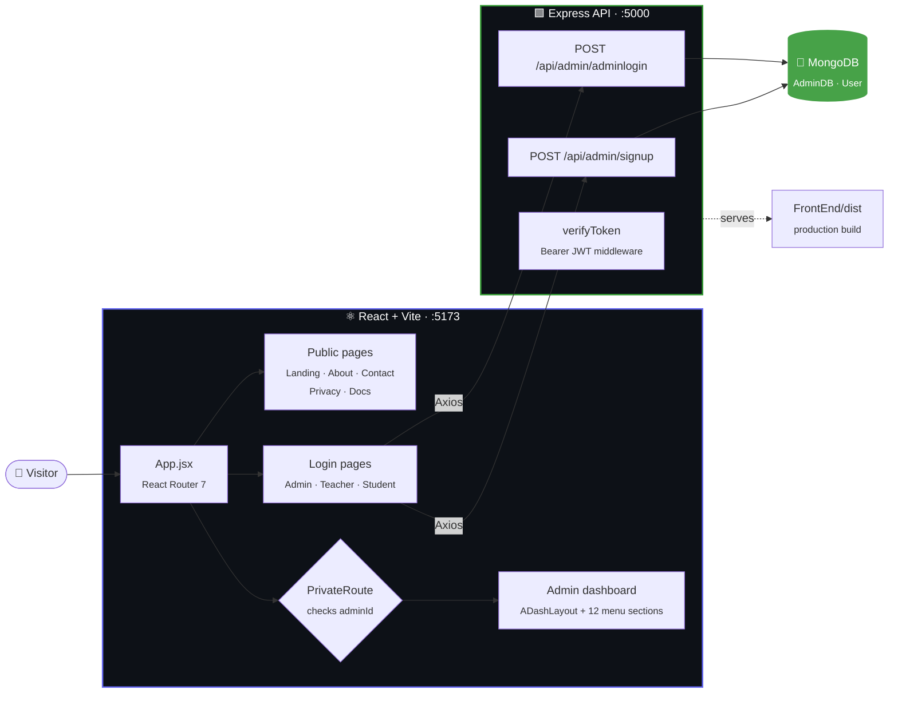
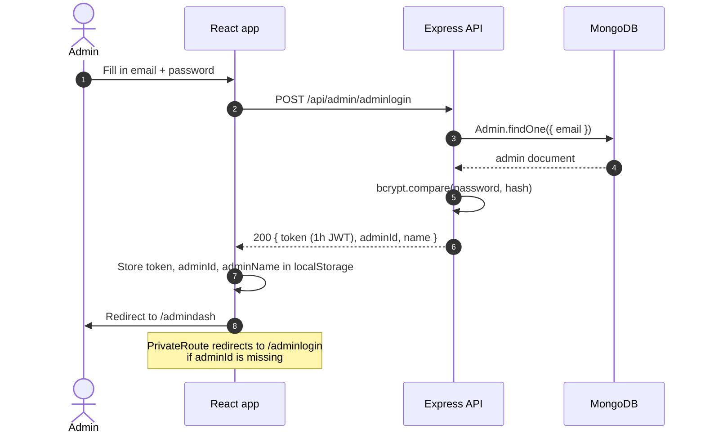

<div align="center">


**One platform for the whole institution. Role-based dashboards for admins, teachers, and students.**

*Centralised performance data, attendance, marks, and analytics, in a single full-stack web app.*

<br/>

[](#-status)
[](#-stack)
[](#-authentication)
[](#)

<br/>


<br/>

[**Overview**](#-what-it-does) &nbsp;·&nbsp;
[**Architecture**](#-architecture) &nbsp;·&nbsp;
[**Auth**](#-authentication) &nbsp;·&nbsp;
[**Dashboard**](#-admin-dashboard) &nbsp;·&nbsp;
[**Status**](#-status) &nbsp;·&nbsp;
[**API**](#-api) &nbsp;·&nbsp;
[**Run locally**](#-run-locally) &nbsp;·&nbsp;
[**Roadmap**](#-roadmap)

</div>

<br/>

---

## 🎓 What it does

Gradyze handles the operational side of an academic institution.

| 🌐 Public site | 🔐 Role-based access | 🛠 Admin workspace | ⚙️ REST backend |
|---|---|---|---|
| Landing, features, pricing, testimonials, about, contact, privacy, docs | Separate Admin, Teacher, and Student entry points | Protected dashboard with a 12-section academic management menu | Express + MongoDB, JWT-signed sessions |

**The six pillars the product is built around:**

| | Pillar | |
|:-:|---|---|
| 📊 | **Centralised performance data** | One source of truth for marks and results |
| 🔎 | **Learning challenge detection** | Spot struggling students early |
| 🧭 | **Data-driven academic support** | Analytics for faculty and students |
| 🗂 | **Administrative efficiency** | Less paperwork, faster workflows |
| 💬 | **Enhanced communication** | Notifications and feedback loops |
| 🛡 | **Reliability** | Token-based, protected access |

<br/>

## 🏗 Architecture



In production the Express server also serves the built React app from `FrontEnd/dist` and falls back to `index.html` for client-side routes.

<br/>

## 🔐 Authentication



| Piece | How it works |
|---|---|
| **Signup** | Requires `name`, `email`, `password`, `university`, `college`. Rejects duplicate emails. Password is hashed with `bcryptjs` (10 rounds) |
| **Login** | Generic `Invalid email or password` for both unknown email and wrong password, so it doesn't leak which one failed |
| **Token** | JWT signed with `JWT_SECRET`, **1 hour** expiry, carries the admin `id` (and `name` on login) |
| **Guard** | `PrivateRoute` redirects unauthenticated visitors to `/adminlogin` |
| **Middleware** | `verifyToken` reads `Authorization: Bearer <token>`, verifies it, and attaches `req.adminId` |

<br/>

## 🧭 Admin dashboard

`ADashLayout` gives every section a shared sidebar, greeting header, and logout flow. The menu is organised around four areas:

| 👨‍🏫 Faculty | 👥 Students | 📣 Communication | 🧾 Account |
|---|---|---|---|
| Faculty Management | Student Management | Notifications | Subscription Plan |
| Faculty Analytics | Students' Marks | Feedback | Settings |
| | Students' Analytics | Syllabus | |
| | Attendance Reports | | |

Plus an **Overview** landing section.

<br/>

## 💳 Pricing tiers

| | **Free** | **Personal** ⭐ | **Organization** |
|---|:-:|:-:|:-:|
| Price | `$0` | `$11.99` | `$49.99` |
| Badge | Basic | Most popular | Premium |

<br/>

## 🚦 Status

| Area | Feature | State |
|---|---|:-:|
| 🌐 Public | Landing, features, pricing, testimonials, about, contact, privacy, documentation | ✅ Done |
| 🔐 Auth | Admin signup + login (bcrypt, JWT) | ✅ Done |
| 🔐 Auth | `PrivateRoute` guard for `/admindash` | ✅ Done |
| 🛠 Admin | Dashboard layout, sidebar, logout | ✅ Done |
| 🛠 Admin | Menu sections (faculty, students, marks, attendance, …) | 🟡 Scaffolded · content pending |
| 🎓 Teacher | Login page | 🟡 UI only · no backend yet |
| 🎓 Student | Login page | 🟡 UI only · no backend yet |
| 🎓 Teacher / Student | Dashboards | ⏳ Next |

```
Progress  ██████████░░░░░░░░░░░░░░  public site + admin auth shipped · academic modules next
```

<br/>

## 🛠 Stack

| Layer | Choice | Why |
|---|---|---|
| **UI** |  | Component model for role-based dashboards |
| **Build** |  | Fast HMR and builds |
| **Styling** |   | Utility classes plus scoped page styles |
| **Components & icons** |    | UI primitives and iconography |
| **Routing** |  | Client-side routes and guards |
| **HTTP** |  | Shared API client in `utils/api.js` |
| **Server** |  | Minimal REST API |
| **Database** |   | Document storage with schema validation |
| **Auth** |   | Signed sessions, hashed passwords |
| **Tooling** |   | Linting and backend auto-reload |

<br/>

## 📁 Project structure

```
gradyze/
└── Gradyze.com/Gradyze/
    ├── 🟩 BackEnd/
    │   ├── index.js                  # Express app, Mongo connection, static serving
    │   ├── api/admin/
    │   │   ├── adminSignUpRoute.js   # POST /api/admin/signup
    │   │   └── adminLoginRoute.js    # POST /api/admin/adminlogin
    │   ├── middleware/auth.js        # verifyToken (Bearer JWT)
    │   └── models/useradmin.js       # Admin schema → "User" collection
    │
    └── ⚛️ FrontEnd/src/
        ├── App.jsx                   # Route table
        ├── utils/api.js              # Axios instance
        ├── Pages/
        │   ├── LandingPage · AboutUs · contactus · PPSection · Documentation
        │   ├── AdminLogin · AdminSignup · TeacherLogin · StudentLogin
        │   └── AdminDash · TeacherDash · StudentDash
        └── components/
            ├── Navbar · HeroSection · FeaturesSection · PricingSection
            ├── Testimonials · LoginSection · Footor
            ├── PrivateRoute.jsx
            └── DashBoardMenu/        # 12 admin sections
```

<br/>

## 🔌 API

| Method | Endpoint | Body | Returns |
|:-:|---|---|---|
| `POST` | `/api/admin/signup` | `name`, `email`, `password`, `university`, `college` | `201` + `token`, `adminId` |
| `POST` | `/api/admin/adminlogin` | `email`, `password` | `200` + `token`, `adminId`, `name` |

**Frontend routes**

| Route | Page | Access |
|---|---|:-:|
| `/` | Landing page | 🌐 Public |
| `/aboutus` · `/contactus` · `/privacypolicy` · `/documentation` | Info pages | 🌐 Public |
| `/adminlogin` · `/adminsignup` | Admin auth | 🌐 Public |
| `/teacherlogin` · `/studentlogin` | Teacher and student auth | 🌐 Public |
| `/admindash` | Admin dashboard | 🔒 Guarded |

<br/>

## ⚡ Run locally

**Prerequisites:** Node.js 18+ and MongoDB (local or Atlas).

```bash
git clone https://github.com/aniruddha9674/gradyze.git
cd gradyze/Gradyze.com/Gradyze
```

**1. Backend**

```bash
cd BackEnd
npm install
```

Create `BackEnd/.env`:

```env
PORT=5000
MONGO_URI=mongodb://localhost:27017
JWT_SECRET=<long random string>
```

```bash
npm run dev     # nodemon, auto-reload
# or
npm start       # plain node
```

> [!IMPORTANT]
> Set `PORT=5000`. The frontend's Axios client in `FrontEnd/src/utils/api.js` points at `http://localhost:5000`, while the server's fallback port is `5173`.

> [!NOTE]
> The server connects to the `AdminDB` database and stores admins in the `User` collection. Your `MONGO_URI` should be the cluster or server URI without a database name.

**2. Frontend**

```bash
cd ../FrontEnd
npm install
npm run dev     # http://localhost:5173
```

**3. Production build**

```bash
npm run build   # outputs FrontEnd/dist, served by the Express server
```

The backend allows CORS from `http://localhost:5173` with credentials.

<br/>

## 🗺 Roadmap

- [x] Public marketing site (landing, pricing, testimonials, about, contact, privacy, docs)
- [x] Admin signup and login with bcrypt + JWT
- [x] Protected admin dashboard shell with 12-section menu
- [ ] Wire `verifyToken` onto protected API routes
- [ ] Faculty and student management (CRUD)
- [ ] Marks entry and results
- [ ] Attendance tracking and reports
- [ ] Teacher backend + dashboard
- [ ] Student portal with results and timetable
- [ ] Role-based permissions per academic tool
- [ ] Analytics with charts (faculty and student)
- [ ] Email notifications for fee reminders
- [ ] CSV import/export for bulk student records
- [ ] Multi-institution support (tenant per school)

<br/>

## 🤝 Contributing

Personal project, but feedback and issues are welcome. Open an issue or reach out directly.

<br/>

---

<div align="center">

**Aniruddha Nalawade**

[](mailto:aniruddhanalawade1234@gmail.com)
[](https://github.com/aniruddha9674)
[](https://linkedin.com/in/aniruddha-nalawade)

[⭐ Star the repo](https://github.com/aniruddha9674/gradyze) &nbsp;·&nbsp;
[🐛 Report an issue](https://github.com/aniruddha9674/gradyze/issues)

</div>
